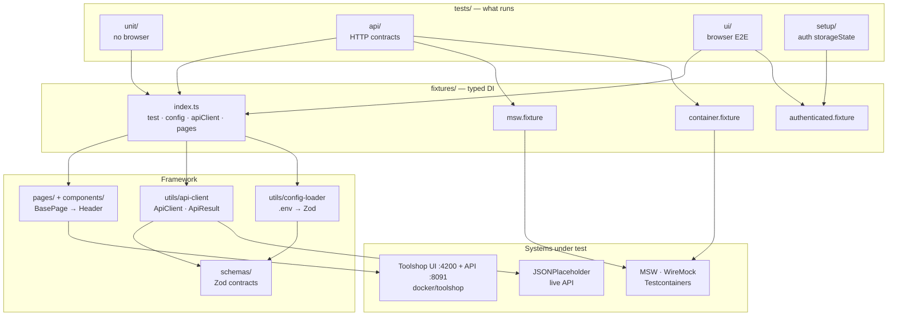
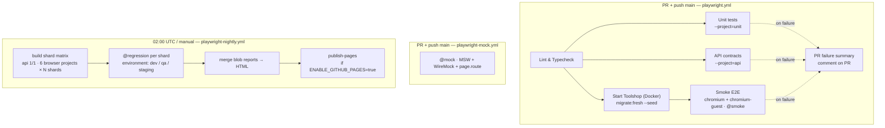

# Playwright TypeScript Test Automation Framework

My Playwright + TypeScript practice framework for advanced patterns beyond my production work: Page Object Model, Zod contracts, typed fixtures, tiered CI with sharding, and API mocking with MSW and WireMock.

---

## Quick start

```bash
npm install
npx playwright install
cp .env.example .env.dev
npm run test:pr        # CI PR tier — ~10s
```

---

## Architecture snapshot



---

## Running tests

| Command                   | What runs                    | When to use               |
| ------------------------- | ---------------------------- | ------------------------- |
| `npm run test:pr`         | unit + api + `@smoke`        | Before every push         |
| `npm run test:smoke`      | Critical path                | Quick confidence          |
| `npm run test:regression` | Full `@regression`           | Pre-release               |
| `npm run test:shard`      | Pass `--shard=i/N` + filters | Simulate CI sharding      |
| `npm run test:mock`       | MSW + Docker + `page.route`  | Mocking work              |
| `npm run test:unit`       | Framework unit tests         | After utils changes       |
| `npm run test:api`        | Live API contracts           | After API client changes  |
| `npm run test:ui`         | UI E2E chromium              | After page object changes |
| `npm run validate`        | typecheck + lint + format    | Quality gate              |

---

## Project structure

```
playwright-ts-framework/
├── schemas/                   # Zod — single source of truth
├── mocks/                     # MSW handlers
├── docker/wiremock/           # Testcontainers stub mappings
├── fixtures/                  # Typed DI layers (base, auth, msw, container)
├── pages/                     # Page Objects
├── builders/                  # Fluent test data
├── types/                     # Branded types, unions
├── utils/                     # API clients, config, route mocks
├── tests/
│   ├── unit/                  # No browser
│   ├── api/                   # HTTP contracts + mocks
│   ├── ui/                    # Browser E2E
│   └── setup/                 # Auth storageState
└── .github/
    ├── workflows/             # PR, nightly, mock
    └── actions/               # Reusable composite actions
```

---

## Demo targets

| Layer     | Target                                                  | Project                           |
| --------- | ------------------------------------------------------- | --------------------------------- |
| Unit      | Framework code                                          | `unit`                            |
| API       | [JSONPlaceholder](https://jsonplaceholder.typicode.com) | `api`                             |
| API mocks | MSW + WireMock Docker                                   | `api-mock`                        |
| UI        | Toolshop (local Docker, `docker/toolshop`)              | `chromium` / `firefox` / `webkit` |

---

## CI tiers



### Required branch protection checks

On `main`, require these status checks from the PR workflow:

- `Lint & Typecheck`
- `Unit tests`
- `API contracts`
- `Smoke E2E`

### CI reports

1. Failed PR → workflow run → **Artifacts** → `playwright-html-report-*`
2. Open `index.html` locally: `npm run report`
3. Traces: download `playwright-test-results-*` → [trace.playwright.dev](https://trace.playwright.dev)
4. Nightly dashboard: enable **Settings → Pages → Source: GitHub Actions**, set repo variable `ENABLE_GITHUB_PAGES=true`, then re-run nightly

```bash
CI=true npm run test:pr    # reproduce PR tier locally
```

---

## Code patterns

```typescript
// API contract (live)
const users = await apiClient.getValidated(API_ENDPOINTS.users, ApiUsersSchema);

// Authenticated UI
import { authenticatedTest as test } from '@fixtures/authenticated.fixture';

// CI tiering
test('...', { tag: ['@smoke', '@regression'] }, async () => { ... });
```

---

## License

Personal project, shared for reference.

### Review hardening

Shell/CI environment variables override local dotenv files. Environment files are ignored;
copy `.env.example` for each environment you need. Browser commands include their guest
projects; direct `--project=chromium` selects only the authenticated browser project.
Use `--project=chromium-guest` to run login and guest-access checks without auth setup.

Mock tests run on every PR and main/master push. Quarantined tests are excluded by default;
use `npm run test:quarantine` for an explicit investigation run.

