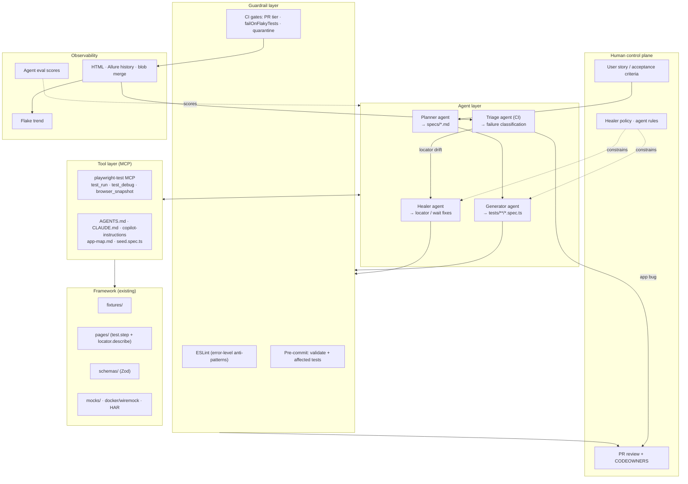
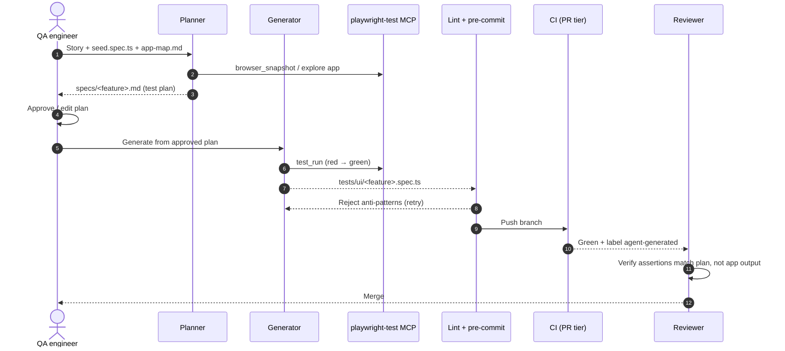
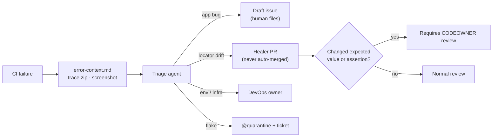
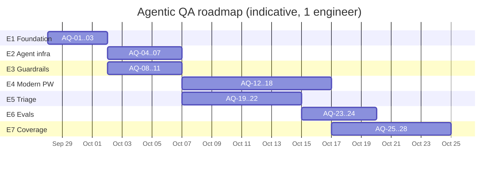

# Agentic QA roadmap

Plan to move this repository from a **well-structured Playwright framework** to a **production-grade agentic test automation framework**: AI agents plan, generate, run, heal, and triage tests, inside guardrails that keep humans in control of what "correct" means.

| Related doc                                  | Purpose                                      |
| -------------------------------------------- | -------------------------------------------- |
| [ARCHITECTURE.md](./ARCHITECTURE.md)         | Current framework design                     |
| [LEARNING-BACKLOG.md](./LEARNING-BACKLOG.md) | Warmup tickets (T-xx) — some are reused here |
| [LEARNING-TASKS.md](./LEARNING-TASKS.md)     | Medium–hard SDET tasks (H-xx)                |
| [../AGENTS.md](../AGENTS.md)                 | Agent brief                                  |

Playwright lockfile version today: **1.61.0** · latest on npm: **1.63.0** · `package.json` range: `^1.52.0`.

---

## 1. Assessment summary

### What is already production-grade

- Test pyramid with 8 Playwright projects (`unit` → `api` / `api-mock` → `setup` → browser projects)
- Typed fixture layers (`@fixtures/index`, `authenticated`, `msw`, `container`)
- Zod contracts for API responses, env config, and test data
- Three mocking layers: MSW (`fetch`), WireMock via Testcontainers (`request`), `page.route` (browser)
- CI tiers: fast PR (`retries: 0`), sharded nightly with blob reports, mock tier
- Tag taxonomy enforced by `playwright/valid-test-tags`

### What is missing (the gap this roadmap closes)

| Area                  | Gap                                                                                                                                                                                                   |
| --------------------- | ----------------------------------------------------------------------------------------------------------------------------------------------------------------------------------------------------- |
| **Agent runtime**     | No Playwright Test Agents (planner / generator / healer), no MCP config, no seed test, no `specs/` plans                                                                                              |
| **Agent portability** | Agent brief and skills exist only under `.cursor/`; no `CLAUDE.md` or Copilot instructions; `skills-lock.json` references `archify` but `.agents/skills/` is empty                                    |
| **Guardrails**        | Anti-patterns are mostly `warn`, not `error`; no pre-commit hook; no policy stopping a healer from "fixing" a real bug by editing expected values                                                     |
| **Evaluation**        | No way to measure whether agent-generated or agent-healed tests are any good                                                                                                                          |
| **Triage**            | CI failure comment only links artifacts; no classification (app bug vs locator drift vs env vs flake)                                                                                                 |
| **Flake management**  | `@quarantine` tag is allowed but no job runs it; no `failOnFlakyTests`; no flake history                                                                                                              |
| **Modern Playwright** | No `test.step`, `locator.describe()`, ARIA snapshots, visual tests, a11y, `page.consoleMessages()` / `pageErrors()`, HAR replay, `page.clock`, `failOnFlakyTests`, `captureGitInfo`, `--only-changed` |
| **Hygiene**           | `.env.dev` / `.env.qa` / `.env.staging` committed with credentials; CI on Node 20 (EOL April 2026) and `setup-node@v4`; no browser cache                                                              |
| **Coverage**          | 5 UI specs; no cart / checkout / sort journeys; `page.route` test mocks a `setContent` page, not the app                                                                                              |

---

## 2. Target architecture

### 2.1 Layered view



### 2.2 Agent loop (story → merged test)



### 2.3 Failure loop (CI red → fix or bug)



### 2.4 Guardrail principles

1. **Humans own the oracle.** Agents may change _how_ a test finds an element; they may not change _what_ the test expects without human review.
2. **Agents write through the same gates as humans.** Lint, typecheck, pre-commit, PR tier. No bypass flags.
3. **Nothing auto-merges.** Healer and triage output is always a PR or a draft for a human.
4. **Measure the agents.** Pass rate on a fixed benchmark, false-heal rate, and time-to-green are tracked.
5. **One brief, many tools.** `AGENTS.md` is the source of truth; tool-specific files point at it.

---

## 3. Phased plan

| Phase | Epic                        | Goal                                                 | Tickets       | Exit criteria                                                                                   |
| ----- | --------------------------- | ---------------------------------------------------- | ------------- | ----------------------------------------------------------------------------------------------- |
| 0     | **E1 Foundation**           | Upgrade and clean hygiene                            | AQ-01 – AQ-03 | 1.63 pinned, Node LTS in CI, no creds in git                                                    |
| 1     | **E2 Agent infrastructure** | Agents can see and run the app                       | AQ-04 – AQ-07 | `init-agents` output checked in; planner produces a plan from `seed.spec.ts`                    |
| 2     | **E3 Guardrails**           | Agent output can't bypass rules                      | AQ-08 – AQ-11 | Anti-patterns fail lint; pre-commit active; healer policy documented and enforced by CODEOWNERS |
| 3     | **E4 Modern Playwright**    | Framework uses current APIs agents rely on           | AQ-12 – AQ-18 | Steps + descriptions in traces; ARIA, a11y, visual layers exist                                 |
| 4     | **E5 Reliability & triage** | CI failures are classified, flakes contained         | AQ-19 – AQ-22 | Triage comment on red PRs; quarantine job; healer workflow                                      |
| 5     | **E6 Evaluation**           | Agent quality is measured                            | AQ-23 – AQ-24 | Benchmark runs on demand with a score                                                           |
| 6     | **E7 Coverage**             | Critical journeys covered through the agent pipeline | AQ-25 – AQ-28 | Cart, checkout, sort covered; real-app route mocks                                              |



---

## 4. Ticket index

| ID                                                                   | Title                                                          | Epic | Priority | Effort | Depends on   | Status |
| -------------------------------------------------------------------- | -------------------------------------------------------------- | ---- | -------- | ------ | ------------ | ------ |
| [AQ-01](#aq-01--upgrade-playwright-to-163-and-pin)                   | Upgrade Playwright to 1.63 and pin                             | E1   | P0       | S      | —            | Open   |
| [AQ-02](#aq-02--modernise-ci-runtime-and-cache-browsers)             | Modernise CI runtime and cache browsers                        | E1   | P0       | S      | —            | Open   |
| [AQ-03](#aq-03--remove-committed-credentials-from-env-files)         | Remove committed credentials from env files                    | E1   | P0       | S      | —            | Open   |
| [AQ-04](#aq-04--initialise-playwright-test-agents)                   | Initialise Playwright Test Agents                              | E2   | P0       | M      | AQ-01        | Open   |
| [AQ-05](#aq-05--check-in-mcp-server-config)                          | Check in MCP server config                                     | E2   | P0       | S      | AQ-01        | Open   |
| [AQ-06](#aq-06--single-source-agent-brief-across-tools)              | Single-source agent brief across tools                         | E2   | P1       | S      | —            | Open   |
| [AQ-07](#aq-07--app-map-and-specs-folder-for-planner)                | App map and `specs/` folder for planner                        | E2   | P1       | M      | AQ-04        | Open   |
| [AQ-08](#aq-08--promote-anti-pattern-lint-rules-to-error)            | Promote anti-pattern lint rules to error                       | E3   | P0       | S      | —            | Open   |
| [AQ-09](#aq-09--pre-commit-hook)                                     | Pre-commit hook                                                | E3   | P1       | S      | AQ-08        | Open   |
| [AQ-10](#aq-10--healer-policy-and-codeowners)                        | Healer policy and CODEOWNERS                                   | E3   | P0       | M      | AQ-04        | Open   |
| [AQ-11](#aq-11--agent-generated-pr-template-and-label)               | Agent-generated PR template and label                          | E3   | P2       | S      | —            | Open   |
| [AQ-12](#aq-12--teststep-and-locatordescribe-in-page-objects)        | `test.step` and `locator.describe()` in page objects           | E4   | P1       | M      | AQ-01        | Open   |
| [AQ-13](#aq-13--fail-on-uncaught-page-errors)                        | Fail on uncaught page errors                                   | E4   | P1       | S      | AQ-01        | Open   |
| [AQ-14](#aq-14--aria-snapshot-assertions)                            | ARIA snapshot assertions                                       | E4   | P1       | M      | AQ-01        | Open   |
| [AQ-15](#aq-15--accessibility-layer-with-axe)                        | Accessibility layer with axe                                   | E4   | P1       | M      | —            | Open   |
| [AQ-16](#aq-16--visual-regression-in-docker)                         | Visual regression in Docker                                    | E4   | P2       | L      | AQ-01        | Open   |
| [AQ-17](#aq-17--har-replay-and-pageclock)                            | HAR replay and `page.clock`                                    | E4   | P2       | M      | —            | Open   |
| [AQ-18](#aq-18--config-failonflakytests-capturegitinfo-only-changed) | Config: `failOnFlakyTests`, `captureGitInfo`, `--only-changed` | E4   | P1       | S      | AQ-01        | Open   |
| [AQ-19](#aq-19--quarantine-job)                                      | Quarantine job                                                 | E5   | P1       | S      | AQ-18        | Open   |
| [AQ-20](#aq-20--flake-and-duration-history)                          | Flake and duration history                                     | E5   | P2       | M      | AQ-19        | Open   |
| [AQ-21](#aq-21--ai-failure-triage-in-ci)                             | AI failure triage in CI                                        | E5   | P1       | L      | AQ-04        | Open   |
| [AQ-22](#aq-22--healer-workflow-manual-dispatch)                     | Healer workflow (manual dispatch)                              | E5   | P2       | M      | AQ-10, AQ-21 | Open   |
| [AQ-23](#aq-23--agent-eval-benchmark)                                | Agent eval benchmark                                           | E6   | P1       | L      | AQ-04, AQ-10 | Open   |
| [AQ-24](#aq-24--agent-quality-metrics)                               | Agent quality metrics                                          | E6   | P2       | M      | AQ-23        | Open   |
| [AQ-25](#aq-25--critical-journeys-via-the-agent-pipeline)            | Critical journeys via the agent pipeline                       | E7   | P1       | L      | AQ-07, AQ-10 | Open   |
| [AQ-26](#aq-26--route-mocks-against-the-real-app)                    | Route mocks against the real app                               | E7   | P2       | M      | —            | Open   |
| [AQ-27](#aq-27--consistent-test-data-access)                         | Consistent test data access                                    | E7   | P2       | S      | —            | Open   |
| [AQ-28](#aq-28--performance-smoke)                                   | Performance smoke                                              | E7   | P2       | M      | —            | Open   |

**Effort:** S ≤ half day · M 1–2 days · L 3–5 days.

**Suggested first sprint:** AQ-01 → AQ-03 → AQ-08 → AQ-04 → AQ-05 → AQ-10. That makes the repo genuinely agentic _and_ safe before any agent writes code.

---

## 5. Tickets

Every ticket uses this shape:

```markdown
## AQ-XX — Title

| Epic | Priority | Effort | Layer | Depends on |

### Problem

### Scope

### Files

### Acceptance criteria

### Out of scope
```

---

### Epic E1 — Foundation

## AQ-01 — Upgrade Playwright to 1.63 and pin

| Epic | Priority | Effort | Layer | Depends on |
| ---- | -------- | ------ | ----- | ---------- |
| E1   | P0       | S      | all   | —          |

**Problem.** `package.json` allows `^1.52.0`; the lockfile resolves 1.61.0; npm latest is 1.63.0. Agents read the range and may suggest APIs that don't exist, or miss ones that do. Browser binaries drift between machines.

**Scope**

- Bump `@playwright/test` to `1.63.x` with an exact or `~` range.
- Read the 1.62 and 1.63 release notes; add relevant items to this roadmap.
- `npx playwright install` locally; run full `npm run test:pr` and `npm run test:mock`.
- Update "Playwright lockfile version" lines in `LEARNING-BACKLOG.md`, `LEARNING-TASKS.md`, and this file.

**Files:** `package.json`, `package-lock.json`, `docs/*.md`

**Acceptance criteria**

- [ ] `npx playwright --version` prints 1.63.x
- [ ] `npm run validate` and `npm run test:pr` green
- [ ] Release-note findings appended to §1 or new tickets filed

**Out of scope:** adopting new APIs (E4 tickets do that).

---

## AQ-02 — Modernise CI runtime and cache browsers

| Epic | Priority | Effort | Layer | Depends on |
| ---- | -------- | ------ | ----- | ---------- |
| E1   | P0       | S      | ci    | —          |

**Problem.** `.github/actions/setup-node-playwright/action.yml` pins Node 20 (end of life April 2026) and `actions/setup-node@v4` while `checkout` is on v6. Every job reinstalls browsers.

**Scope**

- Move to the current Node LTS (22 or 24); set `engines.node` to match; add `.nvmrc`.
- Bump `actions/setup-node` to the latest major.
- Cache `~/.cache/ms-playwright` keyed on the Playwright version from `package-lock.json`; on cache hit run `npx playwright install-deps` only.

**Files:** `.github/actions/setup-node-playwright/action.yml`, `package.json`, `.nvmrc`

**Acceptance criteria**

- [ ] All workflows green on new Node
- [ ] Second PR run shows a browser cache hit and faster setup step

**Out of scope:** switching to the Playwright Docker image (optional follow-up).

---

## AQ-03 — Remove committed credentials from env files

| Epic | Priority | Effort | Layer  | Depends on |
| ---- | -------- | ------ | ------ | ---------- |
| E1   | P0       | S      | config | —          |

**Problem.** `.env.dev`, `.env.qa`, `.env.staging` are tracked and contain `E2E_USERNAME` / `E2E_PASSWORD`. They are public Sauce Demo values, but it violates the `AGENTS.md` safety rule and teaches agents that committing credentials is normal.

**Scope**

- Keep non-secret values (URLs, flags) in tracked `.env.<env>` files, or rename to `.env.<env>.defaults`.
- Move credentials to untracked `.env.<env>.local` (gitignored) and GitHub environment secrets (already wired in `configure-test-env`).
- Update `loadConfig()` to layer `defaults` → `local` → `process.env`; Zod still validates.
- Add a secret-scan step (e.g. gitleaks) to the PR `quality` job.

**Files:** `.env.*`, `.gitignore`, `utils/config-loader.ts`, `tests/unit/config-and-schemas.spec.ts`, `.github/workflows/playwright.yml`, `README.md`

**Acceptance criteria**

- [ ] `git ls-files | xargs grep -l E2E_PASSWORD` returns only `.env.example`-style templates with placeholder values
- [ ] Unit test proves layering order
- [ ] Secret scan fails a PR that adds a password

---

### Epic E2 — Agent infrastructure

## AQ-04 — Initialise Playwright Test Agents

| Epic | Priority | Effort | Layer  | Depends on |
| ---- | -------- | ------ | ------ | ---------- |
| E2   | P0       | M      | agents | AQ-01      |

**Problem.** Playwright ships planner, generator, and healer agent definitions (`node_modules/playwright/lib/agents/`), but the repo has never generated them. Agents can't run or debug tests through Playwright's own tooling.

**Scope**

- Run `npx playwright init-agents --loop=claude` and `--loop=vscode` (Cursor / Copilot).
- Create `tests/seed.spec.ts` that uses `@fixtures/index` or `authenticatedTest`, so generated tests start from framework fixtures, not raw `@playwright/test`.
- Edit generated agent files to reference `AGENTS.md` rules: fixture imports, tags, page objects, no raw locators in specs.
- Document regeneration: re-run `init-agents` after every Playwright upgrade and re-apply edits (keep a short patch note).

**Files:** `.claude/agents/*`, `.github/chatmodes/*` or equivalent generated paths, `tests/seed.spec.ts`, `playwright.config.ts` (seed project if needed), `AGENTS.md`

**Acceptance criteria**

- [ ] Planner produces a plan from `seed.spec.ts` for the inventory page
- [ ] Generator turns that plan into a spec that passes lint and imports from `@fixtures/*`
- [ ] Healer fixes a deliberately broken locator in a scratch branch
- [ ] Regeneration steps documented

---

## AQ-05 — Check in MCP server config

| Epic | Priority | Effort | Layer  | Depends on |
| ---- | -------- | ------ | ------ | ---------- |
| E2   | P0       | S      | agents | AQ-01      |

**Problem.** No `.mcp.json` / `.cursor/mcp.json`. Each developer wires Playwright MCP differently, or not at all.

**Scope**

- Add project-scoped MCP config for the `playwright-test` server (from AQ-04) and, optionally, the Playwright browser MCP for exploratory work.
- Pin the server version to the Playwright version.
- Run MCP with `TEST_ENV=dev` and headless by default.

**Files:** `.mcp.json`, `.cursor/mcp.json`, `README.md` (setup section)

**Acceptance criteria**

- [ ] Fresh clone + `npm ci` → Claude Code and Cursor both list the MCP tools
- [ ] No credentials in MCP config

---

## AQ-06 — Single-source agent brief across tools

| Epic | Priority | Effort | Layer  | Depends on |
| ---- | -------- | ------ | ------ | ---------- |
| E2   | P1       | S      | agents | —          |

**Problem.** Agent guidance lives in `.cursor/agents` and `.cursor/skills`. Claude Code, Copilot, and other tools get a partial view. `skills-lock.json` references `archify`, but `.agents/skills/` is empty.

**Scope**

- Keep `AGENTS.md` as the source of truth; make it tool-neutral (it currently says "Cursor Agent Guide").
- Add `CLAUDE.md` and `.github/copilot-instructions.md` as thin pointers (or symlinks) to `AGENTS.md`.
- Move shared skill content to a neutral path (e.g. `.agents/skills/`) and point `.cursor/skills` at it, or document why Cursor-only is intended.
- Either restore the `archify` skill or remove it from `skills-lock.json`.

**Files:** `AGENTS.md`, `CLAUDE.md`, `.github/copilot-instructions.md`, `.cursor/**`, `.agents/**`, `skills-lock.json`

**Acceptance criteria**

- [ ] Same rules visible from Claude Code, Cursor, and Copilot
- [ ] No dangling skill references

---

## AQ-07 — App map and `specs/` folder for planner

| Epic | Priority | Effort | Layer         | Depends on |
| ---- | -------- | ------ | ------------- | ---------- |
| E2   | P1       | M      | agents · docs | AQ-04      |

**Problem.** Agents re-explore Sauce Demo from scratch every time. There is no machine-readable inventory of routes, personas, page objects, and flows, and no home for test plans.

**Scope**

- `docs/app-map.md`: routes → page object → key test ids → personas (from `test-data/login-users.json`) → known flows.
- `specs/` folder for planner output, one Markdown plan per feature, reviewed like code.
- Plan template: preconditions, steps, expected results, tags, layer (ui/api/mock), out of scope.

**Files:** `docs/app-map.md`, `specs/README.md`, `specs/_template.md`, `AGENTS.md`

**Acceptance criteria**

- [ ] Planner prompt references `app-map.md` and writes to `specs/`
- [ ] One reviewed plan exists (inventory or cart)

---

### Epic E3 — Guardrails

## AQ-08 — Promote anti-pattern lint rules to error

| Epic | Priority | Effort | Layer | Depends on |
| ---- | -------- | ------ | ----- | ---------- |
| E3   | P0       | S      | lint  | —          |

**Problem.** `eslint-plugin-playwright` `flat/recommended` leaves several rules at `warn`. Agents ignore warnings. Nothing stops a spec importing `test` from `@playwright/test` directly.

**Scope** (in `eslint.config.js`, `tests/**/*.ts`)

- `playwright/no-wait-for-timeout`, `no-force-option`, `no-skipped-test`, `no-page-pause`, `no-networkidle`, `no-conditional-in-test`, `no-raw-locators` (allow list for mock specs) → `error`.
- `no-restricted-imports`: forbid `test` from `@playwright/test` in `tests/**` (except `tests/unit/**` if intentional).
- Page objects: forbid `expect` import in `pages/**` (assertions stay in specs).

**Files:** `eslint.config.js`, any specs that now fail

**Acceptance criteria**

- [ ] `npm run lint` green on main after fixes
- [ ] A scratch spec with `waitForTimeout` or a raw `@playwright/test` import fails lint

---

## AQ-09 — Pre-commit hook

| Epic | Priority | Effort | Layer   | Depends on |
| ---- | -------- | ------ | ------- | ---------- |
| E3   | P1       | S      | tooling | AQ-08      |

**Problem.** Agents and humans can commit code that only fails in CI.

**Scope**

- Husky + lint-staged: ESLint + Prettier on staged files; `tsc --noEmit`.
- Optional pre-push: `playwright test --only-changed=origin/main --project=unit --project=api`.

**Files:** `package.json`, `.husky/*`, `.lintstagedrc`

**Acceptance criteria**

- [ ] Commit with a lint error is blocked locally
- [ ] Hook runs in under ~20s on a typical change

---

## AQ-10 — Healer policy and CODEOWNERS

| Epic | Priority | Effort | Layer            | Depends on |
| ---- | -------- | ------ | ---------------- | ---------- |
| E3   | P0       | M      | process · agents | AQ-04      |

**Problem.** A healer that makes red tests green can hide real regressions by editing expected text, counts, URLs, or snapshots.

**Scope**

- Write `docs/HEALER-POLICY.md`: allowed changes (locators, waits via web-first assertions, test data setup) vs forbidden-without-review (expected values, `ERROR_MESSAGES` / `ROUTES` constants, Zod schemas, snapshots, deleted assertions, new `test.skip` / `test.fixme`).
- Embed the policy in healer agent instructions (AQ-04).
- `CODEOWNERS`: QA owners for `utils/constants.ts`, `schemas/**`, `**/*-snapshots/**`, `**/*.aria.yml`, `test-data/**`.
- CI check: if a PR labelled `agent-generated` touches those paths, require a CODEOWNER approval (branch protection).

**Files:** `docs/HEALER-POLICY.md`, `.github/CODEOWNERS`, generated healer agent file, `AGENTS.md`

**Acceptance criteria**

- [ ] Healer run on a changed error message does **not** silently update the expected text; it reports "possible app change"
- [ ] PR touching `schemas/**` requests a CODEOWNER review

---

## AQ-11 — Agent-generated PR template and label

| Epic | Priority | Effort | Layer   | Depends on |
| ---- | -------- | ------ | ------- | ---------- |
| E3   | P2       | S      | process | —          |

**Problem.** Reviewers can't tell which PRs were written by an agent or what plan they came from.

**Scope**

- Add an "Agent involvement" section to `.github/pull_request_template.md`: agent used, source plan in `specs/`, assertions changed (Y/N), red-first evidence.
- `agent-generated` label; used by AQ-10 and AQ-24.

**Files:** `.github/pull_request_template.md`, repo labels

**Acceptance criteria**

- [ ] Template renders; label exists and is documented in `AGENTS.md`

---

### Epic E4 — Modern Playwright

## AQ-12 — `test.step` and `locator.describe()` in page objects

| Epic | Priority | Effort | Layer | Depends on |
| ---- | -------- | ------ | ----- | ---------- |
| E4   | P1       | M      | pages | AQ-01      |

**Problem.** Traces and HTML reports show raw actions (`fill`, `click`) with no intent. Agents (healer, triage) parse steps to locate the failing intent. No spec or page object uses `test.step`.

**Scope**

- Add a small `@step()` decorator or `step()` helper in `utils/` wrapping page-object methods in `test.step` with `box: true`.
- Apply to `LoginPage`, `DashboardPage`, `UserProfilePage`.
- Use `locator.describe('Login button')` for page-object locators so traces show readable names.

**Files:** `utils/step.ts`, `pages/*.ts`, `tests/unit/*` (helper test)

**Acceptance criteria**

- [ ] HTML report for `login.spec.ts` shows `Login as standard_user` as one step
- [ ] Trace viewer shows described locator names
- [ ] Failure inside a boxed step points at the spec line, not the page object internals

---

## AQ-13 — Fail on uncaught page errors

| Epic | Priority | Effort | Layer    | Depends on |
| ---- | -------- | ------ | -------- | ---------- |
| E4   | P1       | S      | fixtures | AQ-01      |

**Problem.** `fixtures/index.ts` hand-rolls `console` / `pageerror` listeners that only log. A JS exception in the app never fails a test.

**Scope**

- Replace listeners with `page.consoleMessages()` / `page.pageErrors()` in fixture teardown.
- Attach them to the test report (`testInfo.attach`).
- Fail the test on uncaught `pageErrors()` unless the test opts out (fixture option `allowPageErrors`).

**Files:** `fixtures/index.ts`, `types/*`

**Acceptance criteria**

- [ ] A scratch test injecting `throw new Error()` via `page.evaluate(setTimeout…)` fails with the error attached
- [ ] Existing suite still green

---

## AQ-14 — ARIA snapshot assertions

| Epic | Priority | Effort | Layer | Depends on |
| ---- | -------- | ------ | ----- | ---------- |
| E4   | P1       | M      | ui    | AQ-01      |

**Problem.** Structural UI checks are done element by element. ARIA snapshots are resilient to styling changes, reviewable in diffs, and are what the generator produces.

**Scope**

- Add `toMatchAriaSnapshot` for login form, inventory header, and burger menu, stored as `.aria.yml` files.
- Document when to prefer ARIA snapshot vs targeted assertion vs screenshot in `ARCHITECTURE.md`.

**Files:** `tests/ui/*.spec.ts`, `tests/ui/__snapshots__/*.aria.yml`, `docs/ARCHITECTURE.md`

**Acceptance criteria**

- [ ] Removing the Login button in a route-mocked page makes the snapshot fail with a readable diff
- [ ] `--update-snapshots` flow documented; snapshot paths covered by CODEOWNERS (AQ-10)

---

## AQ-15 — Accessibility layer with axe

| Epic | Priority | Effort | Layer         | Depends on |
| ---- | -------- | ------ | ------------- | ---------- |
| E4   | P1       | M      | ui · fixtures | —          |

**Scope**

- Add `@axe-core/playwright`; `a11y` fixture exposing `checkA11y(options)` scoped to WCAG 2.1 AA.
- New tag `@a11y` (add to `valid-test-tags`); scan login and inventory pages.
- Known-violation allow list in `test-data/a11y-baseline.json` so the suite starts green and only regressions fail.

**Files:** `fixtures/a11y.fixture.ts`, `tests/ui/a11y.spec.ts`, `utils/tags.ts`, `eslint.config.js`, `test-data/a11y-baseline.json`

**Acceptance criteria**

- [ ] Violations attached as JSON to the report
- [ ] A new violation (injected via `page.route`) fails the test

---

## AQ-16 — Visual regression in Docker

| Epic | Priority | Effort | Layer   | Depends on |
| ---- | -------- | ------ | ------- | ---------- |
| E4   | P2       | L      | ui · ci | AQ-01      |

**Problem.** `toHaveScreenshot` is only in skill docs. Screenshots rendered on macOS differ from Linux CI.

**Scope**

- `@visual` tag + `chromium-visual` project; baselines generated in the official Playwright Docker image (`npm run test:visual:update` via `docker run`).
- Mask dynamic regions; `maxDiffPixelRatio` in config, not per test.
- Nightly only.

**Files:** `playwright.config.ts`, `tests/ui/visual.spec.ts`, `package.json`, `.github/workflows/playwright-nightly.yml`

**Acceptance criteria**

- [ ] Baselines reproducible from any OS via Docker
- [ ] Diff images uploaded as artifacts on failure

---

## AQ-17 — HAR replay and `page.clock`

| Epic | Priority | Effort | Layer | Depends on |
| ---- | -------- | ------ | ----- | ---------- |
| E4   | P2       | M      | mocks | —          |

**Scope**

- `routeFromHAR` helper in `utils/route-mocks.ts` with a record mode (`HAR_UPDATE=true`) and replay mode; one spec proving replay.
- `page.clock` example for time-dependent UI (lesson material if Sauce Demo has none).
- Add HAR to the mocking decision table in `ARCHITECTURE.md` §6.

**Files:** `utils/route-mocks.ts`, `mocks/har/*`, `tests/ui/*.spec.ts`, `docs/ARCHITECTURE.md`

**Acceptance criteria**

- [ ] Replay spec passes with network disabled to the real host (`route.abort` fallback)

---

## AQ-18 — Config: `failOnFlakyTests`, `captureGitInfo`, `--only-changed`

| Epic | Priority | Effort | Layer       | Depends on |
| ---- | -------- | ------ | ----------- | ---------- |
| E4   | P1       | S      | config · ci | AQ-01      |

**Scope**

- `failOnFlakyTests: isNightly` (nightly retries once; a pass-on-retry now fails the run instead of hiding).
- `captureGitInfo: { commit: true, diff: isCi }` so reports and triage agents see the change under test.
- PR tier: add a job running `--only-changed=origin/${{ github.base_ref }}` across all browser projects as fast signal.
- `npm run test:last-failed` script.

**Files:** `playwright.config.ts`, `package.json`, `.github/workflows/playwright.yml`

**Acceptance criteria**

- [ ] Forced flaky test (fails first attempt only) fails nightly
- [ ] HTML report shows commit metadata

---

### Epic E5 — Reliability & triage

## AQ-19 — Quarantine job

| Epic | Priority | Effort | Layer | Depends on |
| ---- | -------- | ------ | ----- | ---------- |
| E5   | P1       | S      | ci    | AQ-18      |

**Problem.** `@quarantine` is an allowed tag but nothing runs quarantined tests, so they rot.

**Scope**

- Exclude `@quarantine` from PR and nightly (`--grep-invert`).
- Nightly `quarantine` job runs them with `--repeat-each=5`, non-blocking; summary lists tests stable 5/5 as "ready to release".
- Rule in `AGENTS.md`: quarantine requires a linked ticket in the test annotation.

**Files:** `.github/workflows/playwright-nightly.yml`, `package.json`, `AGENTS.md`

**Acceptance criteria**

- [ ] Quarantined test doesn't fail PR; appears in nightly quarantine summary

---

## AQ-20 — Flake and duration history

| Epic | Priority | Effort | Layer     | Depends on |
| ---- | -------- | ------ | --------- | ---------- |
| E5   | P2       | M      | reporting | AQ-19      |

**Scope**

- Persist Allure history (or merged JSON reports) across nightly runs, e.g. on GitHub Pages per `.cursor/skills/devops/reporting.md`.
- Surface top-10 flakiest and slowest tests; feed into triage (AQ-21).

**Acceptance criteria**

- [ ] Trend view covers ≥ 7 nightly runs

---

## AQ-21 — AI failure triage in CI

| Epic | Priority | Effort | Layer       | Depends on |
| ---- | -------- | ------ | ----------- | ---------- |
| E5   | P1       | L      | ci · agents | AQ-04      |

**Problem.** A red PR produces a comment with artifact links. Someone still has to download a trace to learn whether it's an app bug, locator drift, env outage, or flake.

**Scope**

- Job `triage` (on failure) collects `test-results/**/error-context.md`, error messages, `captureGitInfo` diff, and flake history.
- Calls an LLM (secret `ANTHROPIC_API_KEY`, model configurable) with a fixed prompt returning JSON: `{ test, category: app-bug|locator-drift|env|flake|test-bug, confidence, evidence, suggested_action }`.
- Validate the response with Zod; post one PR comment table; never modify code.
- Fork PRs: skip (no secrets), fall back to the existing comment.

**Files:** `.github/workflows/playwright.yml`, `scripts/triage/*.ts`, `schemas/triage.schemas.ts`, `tests/unit/triage.spec.ts`

**Acceptance criteria**

- [ ] Unit tests cover prompt building and schema validation with recorded responses (no live LLM in unit tier)
- [ ] Deliberately broken locator → `locator-drift`; changed expected text → `app-bug` or `test-bug`, not silently healed
- [ ] Cost cap: max N failures sent per run

---

## AQ-22 — Healer workflow (manual dispatch)

| Epic | Priority | Effort | Layer       | Depends on   |
| ---- | -------- | ------ | ----------- | ------------ |
| E5   | P2       | M      | ci · agents | AQ-10, AQ-21 |

**Scope**

- `workflow_dispatch` workflow: input = failing test ids (from triage `locator-drift`), runs the healer headless, opens a PR labelled `agent-generated`.
- Healer policy (AQ-10) enforced; PR body includes before/after locator and trace link.
- Never auto-merge; branch protection unchanged.

**Acceptance criteria**

- [ ] Scratch locator break produces a healer PR that passes PR tier
- [ ] Healer PR changing an expected value is flagged for CODEOWNER review

---

### Epic E6 — Evaluation

## AQ-23 — Agent eval benchmark

| Epic | Priority | Effort | Layer  | Depends on   |
| ---- | -------- | ------ | ------ | ------------ |
| E6   | P1       | L      | agents | AQ-04, AQ-10 |

**Problem.** Without a benchmark, prompt or model changes to the agents are guesswork.

**Scope**

- `evals/` with cases:
  - **Heal:** spec + mutation (renamed test id, changed role name, moved element) + expected fix class.
  - **Must-not-heal:** app behaviour change (different error text) where the correct output is "report bug", not edit.
  - **Generate:** plan in `specs/` + grading rubric (fixture imports, tags, page objects, passes, red-first when app is broken).
- Runner script applies each mutation via `page.route` / HTML fixtures (no real app changes), runs the agent, scores results.

**Files:** `evals/**`, `package.json` (`eval:agents`)

**Acceptance criteria**

- [ ] ≥ 10 cases, including ≥ 3 must-not-heal
- [ ] One command outputs a score table

---

## AQ-24 — Agent quality metrics

| Epic | Priority | Effort | Layer     | Depends on |
| ---- | -------- | ------ | --------- | ---------- |
| E6   | P2       | M      | reporting | AQ-23      |

**Scope:** track per month: eval score, false-heal rate, share of `agent-generated` PRs merged unchanged, triage accuracy (human-confirmed category), mean time-to-green. Publish alongside the report site.

**Acceptance criteria**

- [ ] Metrics page with first baseline values

---

### Epic E7 — Coverage

## AQ-25 — Critical journeys via the agent pipeline

| Epic | Priority | Effort | Layer | Depends on   |
| ---- | -------- | ------ | ----- | ------------ |
| E7   | P1       | L      | ui    | AQ-07, AQ-10 |

**Problem.** Cart, checkout, and sort are uncovered. They are also the right proving ground for plan → generate → review.

**Scope**

- Use planner → reviewed `specs/cart.md`, `specs/checkout.md`, `specs/sort.md` → generator → human review.
- Aligns with warmup tickets [T-02](./LEARNING-BACKLOG.md#t-02--assert-the-cart-not-only-the-badge), [T-08](./LEARNING-BACKLOG.md#t-08--checkout-happy-path), [T-09](./LEARNING-BACKLOG.md#t-09--sort-catalog-with-parameterized-tests). Close those tickets from this work or do them by hand first as a learning baseline to compare against agent output.
- New page objects (`CartPage`, `CheckoutPage`) follow `BasePage` rules.

**Acceptance criteria**

- [ ] Checkout happy path tagged `@smoke`; sort + cart `@regression`
- [ ] PRs carry the agent template (AQ-11) and a comparison note: what the reviewer had to change

---

## AQ-26 — Route mocks against the real app

| Epic | Priority | Effort | Layer   | Depends on |
| ---- | -------- | ------ | ------- | ---------- |
| E7   | P2       | M      | ui-mock | —          |

**Problem.** `tests/ui/network-mock.spec.ts` mocks a page built with `setContent`, which tests the helper, not the application.

**Scope**

- Keep the helper test in `tests/unit` or relabel it as a helper test.
- Add a mock spec against Sauce Demo itself: e.g. `page.route` returning 500 or aborting a static asset / image, and assert the app's degraded state.

**Acceptance criteria**

- [ ] At least one `chromium-mock` test navigates to `baseURL`

---

## AQ-27 — Consistent test data access

| Epic | Priority | Effort | Layer | Depends on |
| ---- | -------- | ------ | ----- | ---------- |
| E7   | P2       | S      | ui    | —          |

**Problem.** `tests/ui/negative-login.spec.ts` calls `loadLoginTestData()` at module level although a `loginTestData` fixture exists. Agents copy whichever pattern they see first.

**Scope**

- Pick one rule (module-level for parameterised case tables, fixture otherwise), document it in `AGENTS.md`, and make specs follow it.

**Acceptance criteria**

- [ ] Rule written down; all specs comply

---

## AQ-28 — Performance smoke

| Epic | Priority | Effort | Layer | Depends on |
| ---- | -------- | ------ | ----- | ---------- |
| E7   | P2       | M      | ui    | —          |

**Scope**

- `@perf` tag: collect LCP / CLS / navigation timing via `PerformanceObserver` in `page.evaluate` on login → inventory; attach JSON to the report.
- Soft budgets in config; nightly only; fail only on large regressions versus a stored baseline.

**Acceptance criteria**

- [ ] Metrics attached per run; budget breach fails nightly with a readable message

---

## 6. Definition of done (roadmap)

- [ ] A QA engineer can go from user story → reviewed plan → generated, passing, lint-clean spec in under an hour
- [ ] Every CI failure on a PR gets a classified triage comment
- [ ] No agent can change an expected value, schema, or snapshot without a CODEOWNER approval
- [ ] Agent quality is a number tracked over time, not an opinion
- [ ] Framework uses current Playwright APIs (steps, descriptions, ARIA, a11y, flaky detection) and is on the latest minor
