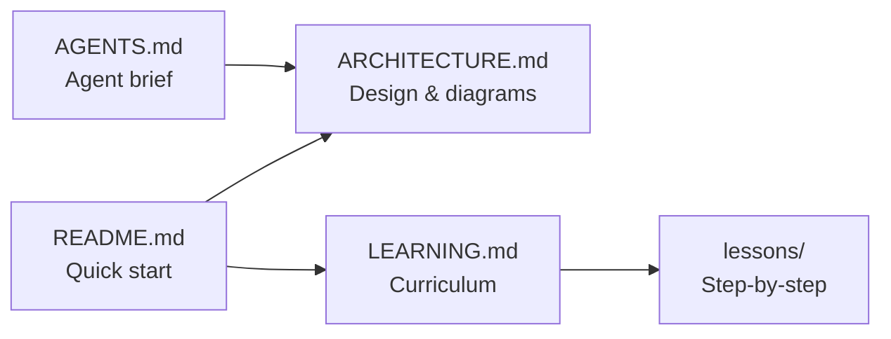

# Documentation Hub

**Recommended starting point:** [four-week Toolshop senior SDET plan](HANDS-ON-MASTERY-PLAN.md) — build, debug, design, and review using this framework. Track your own evidence in [PRACTICE-TRACKER.md](PRACTICE-TRACKER.md). Read [DOCS-REVIEW.md](DOCS-REVIEW.md) before treating older tickets as missing work.

**Primary learning target: Toolshop.** Follow the [environment/integration guide](TOOLSHOP-PRACTICE-GUIDE.md) and [practical exercise briefs](TOOLSHOP-EXERCISE-BRIEFS.md). The existing framework still targets Sauce Demo/JSONPlaceholder; adapting it is a day-3 assignment, not a completed change. Historical T/H tickets remain concept references.

> Playwright + TypeScript SDET framework — architecture, learning path, and visual references.

## Start here

| I want to…                                 | Go to                                                                                                              |
| ------------------------------------------ | ------------------------------------------------------------------------------------------------------------------ |
| Understand how the framework fits together | [ARCHITECTURE.md](./ARCHITECTURE.md)                                                                               |
| Learn Playwright + TypeScript hands-on     | [LEARNING.md](./LEARNING.md)                                                                                       |
| Work practical tickets in this repo        | [LEARNING-BACKLOG.md](./LEARNING-BACKLOG.md) (warmup) · [LEARNING-TASKS.md](./LEARNING-TASKS.md) (**medium–hard**) |
| See all diagrams in one place              | [ARCHITECTURE.md#diagram-index](./ARCHITECTURE.md#diagram-index)                                                   |
| Onboard a Cursor agent                     | [../AGENTS.md](../AGENTS.md)                                                                                       |
| Run tests quickly                          | [../README.md#running-tests](../README.md#running-tests)                                                           |

## Document map

## Lessons

| #   | Topic               | File                                                                     |
| --- | ------------------- | ------------------------------------------------------------------------ |
| 01  | Framework map       | [lessons/01-framework-map.md](./lessons/01-framework-map.md)             |
| 02  | Playwright projects | [lessons/02-playwright-projects.md](./lessons/02-playwright-projects.md) |
| 11  | Mocking strategies  | [lessons/11-mocking-strategies.md](./lessons/11-mocking-strategies.md)   |

Lessons 03–10 are indexed in [LEARNING.md](./LEARNING.md) — ask the agent: _"Teach me Lesson 03"_.
