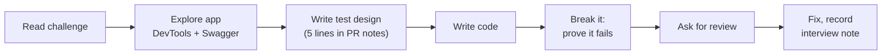

# 30-day Toolshop challenges — you write every line

**Goal:** move this framework from Sauce Demo to your local Toolshop and come out of it able to design and write Playwright + TypeScript test automation on your own, with work you can show in interviews.

**Rules:**

1. **You write the code.** The coach gives the task, acceptance criteria, hints on request, and a review. It gives a solution only if you explicitly ask for one, and then the challenge counts as "assisted".
2. **Quality over quantity.** Twenty challenges, each with a senior-level twist. Five well-defended tests beat fifty clicks.
3. **Prove a test can fail.** Every test must be shown failing for the bug it targets before it counts.
4. **No `waitForTimeout`, no retries to make it green, no `any`.**

Created 24 November 2026. Plan for 5–6 focused hours per day, about 20 working days.

---

## Your local target (verified 24 Nov 2026)

| What        | Where                                                                                                            |
| ----------- | ---------------------------------------------------------------------------------------------------------------- |
| UI          | http://localhost:4200 (Angular, hooks are `data-test="…"`)                                                       |
| API         | http://localhost:8091 · Swagger at `/api/documentation` · raw spec at `/docs?api-docs.json`                      |
| Email       | MailCatcher at http://localhost:1080                                                                             |
| Database    | MariaDB `localhost:3306` · phpMyAdmin at http://localhost:8000                                                   |
| Reset data  | `docker exec pst-laravel-api-1 php artisan migrate:fresh --seed` (local only, never mid-run)                     |
| Seed logins | In `sprint5/API/database/seeders/UserSeeder.php` of your Toolshop checkout. Keep them in a git-ignored env file. |

---

## How each session works

**Prompts that work with the coach:**

- `Start C03`: you get the brief and the questions to answer first.
- `Hint 1 / Hint 2 / Hint 3 for C03`: direction → API name → pseudo-code. Ask for one level at a time.
- `Review C03`: the coach reads your `git diff`, asks you to explain choices, and scores you 0–3.
- `Break something for C10`: the coach injects a hidden fault for you to diagnose.

**Score per challenge:** 0 = can't explain it · 1 = done with hints · 2 = done alone and can explain it · 3 = can explain the alternatives and teach it. Redo anything below 2 before moving on.

---

## Week 1 — Toolshop foundation and first real tests

**Skills:** TypeScript types, `async`/`await`, Zod, locators, assertions, waiting correctly.

### C01 · Typed Toolshop environment contract

- **Build:** A Zod schema and a loader for the Toolshop settings (UI URL, API URL, customer email and password), read from a git-ignored env file. It must be separate from the Sauce Demo config.
- **Accept when:**
  - A missing variable gives **one** error that lists **every** problem.
  - A URL that isn't local (for example the hosted site) is refused.
  - Unit tests cover the pass case, the missing-variables case, and the non-local case.
- **TypeScript:** `z.infer`, `.refine` / `.superRefine`, `safeParse`, `NodeJS.ProcessEnv`, injecting the env as a parameter so the loader is testable.
- **Senior twist:** later the suite will run in Docker, where the API host is `web`, not `localhost`. Decide now how the guard allows that without letting public hosts through.
- **Interview line:** "Config fails fast before any browser starts, and the suite can't hit a shared environment by accident."

### C02 · Toolshop Playwright config and projects

- **Build:** Rework `playwright.toolshop.config.ts` to have an API project and a guest UI project, using C01's loader.
- **Accept when:**
  - `--list` shows that the Toolshop suite and the Sauce Demo suite never pick up each other's specs.
  - Artifacts go to a separate folder.
  - Retries are 0.
- **Senior twist:** `tests/api/toolshop.spec.ts` currently sits inside the Sauce Demo `api` project. Move it, and prove the PR workflow no longer needs Toolshop settings.

### C03 · Product API contract tests

- **Build:** Tests for product list, product detail and a product that doesn't exist. Write the Zod schemas yourself from Swagger, extending `schemas/toolshop.schemas.ts`.
- **Accept when:**
  - The tests check paging consistency (`from`, `to`, `total`), that the detail response matches the item from the list, and the exact status and body for an unknown ID.
- **TypeScript:** generics through `ApiClient.getValidated`, `z.infer`, nullable vs optional.
- **Senior twist:**
  - Write a unit test that feeds the schema a saved JSON response with one business field deleted. It must fail.
  - Decide whether unknown extra fields should pass or fail, and write down why.

### C04 · Catalog page object: search and sort

- **Build:** A `CatalogPage` and guest tests for search and for sorting by price and by name.
- **Accept when:**
  - Locators use `getByTestId` / `getByRole`.
  - The sort assertion compares against a list **you** sorted independently.
  - There are no sleeps.
- **Senior twist:**
  - Watch the Network tab when you search. The request isn't what you'd expect. Work out what to wait on.
  - Prove the test is stable with `--repeat-each=20 --workers=6`.

### C05 · Data-driven filters (Gate 1)

- **Build:** Category × brand × eco-friendly filter tests driven by a typed table of cases.
- **Accept when:**
  - The table has at most 8 rows, and you can justify each combination you dropped.
  - The expected results come from the API, not hard-coded names.
- **TypeScript:** `as const`, `satisfies`, mapped and tuple types, a Zod schema for the case table.
- **Gate:** ask `Break something for C05`, then diagnose the fault with the trace viewer in under 10 minutes.

---

## Week 2 — Authentication, test data and framework design

**Skills:** fixtures (test and worker scope), builders, utility types, error handling, parallel isolation.

### C06 · Log in through the API and reuse the session

- **Build:** A setup project that logs the seeded customer in through `POST /users/login`, puts the token where the Angular app looks for it, and saves `storageState`. Add an authenticated UI project that depends on it.
- **Accept when:**
  - A UI test opens `/account` already signed in.
  - A broken login fails **the setup step**, not 20 tests after it.
- **Senior twist:** find out for yourself where the app stores the token. Use DevTools → Application after a manual login.

### C07 · Customer builder and per-worker customer fixture

- **Build:**
  - `buildToolshopCustomer(overrides)` using faker. Its rules come from the register schema in Swagger.
  - A **worker-scoped** fixture that registers a fresh customer and logs them in.
- **Accept when:** a cart test runs `--workers=4 --repeat-each=3` with no interference between tests.
- **TypeScript:** `Partial<T>`, `Required<T>`, the second generic of `test.extend<Test, Worker>`, `try/finally`.
- **Senior twist:** first make the fixture test-scoped with a fixed email, watch it fail, and explain why. Then fix it.

### C08 · Authorization matrix

- **Build:** A data-driven spec covering guest, customer A, customer B and admin against 4–5 endpoints. Include B trying to read A's invoice.
- **Accept when:**
  - The expected status codes come from Swagger or from observed behaviour you have documented.
  - A failure message shows the actor, the endpoint and the response body.
- **TypeScript:** `Record<Actor, number>`, string-literal union types, template literal test names.
- **Senior twist:** find one place where the UI _hides_ a control. Prove whether the server actually enforces the restriction.

### C09 · Typed cart API client

- **Build:** A `ToolshopCartClient` with methods to create a cart, add an item, change quantity, remove an item and read the cart. Each one validates the response.
- **Accept when:**
  - Tests cover the happy path, a quantity of 0 or below, an unknown product, and a cart total that you compute independently.
- **TypeScript:** reuse the existing `ApiResult` discriminated union for failures, and narrow on `result.ok`.
- **Senior twist:** money. Decide how you compare decimal totals (rounding, `toBeCloseTo` versus integer cents) and defend the choice.

### C10 · Retire Sauce Demo as the default (Gate 2)

- **Build:** Decide how the repo treats Sauce Demo: delete it, move it under `reference/`, or keep both targets. Carry out your decision. Update `package.json` scripts, CI and the README.
- **Accept when:**
  - `npm run validate` is green.
  - Running `npm test` runs Toolshop.
  - A one-page decision record (ADR) explains the trade-off.
- **Gate:** review an unseen flawed diff from the coach and rank the problems by impact.

---

## Week 3 — End-to-end journeys and hard browser cases

**Skills:** arranging through the API and acting in the UI, state models, async polling, mocking, accessibility.

### C11 · Checkout end to end

- **Build:** Set up a cart through the API, complete the checkout steps in the UI, then confirm through the API that the invoice was saved with the right lines and total.
- **TypeScript:** model the payment methods (bank transfer, card, buy-now-pay-later, gift card…) as a **discriminated union** so it's impossible to pass card fields with bank transfer.
- **Senior twist:** enter invalid card details, switch payment method, then switch back. What _should_ happen? Write the expected behaviour before you test it.

### C12 · Invoice PDF and password-reset email

- **Build:**
  - Download an invoice PDF. Register the download listener _before_ clicking, then check the file is really a PDF.
  - Request a password reset for a worker customer and read the email from MailCatcher's API.
- **Accept when:** waiting uses `expect.poll` with a deadline, and the email is matched to your test by its unique recipient.

### C13 · Mocking at the right layer

- **Build:**
  - Use `page.route` to make the postcode lookup fail, time out and return a malformed body, and assert how the UI recovers.
  - Mock `/sales-stream` (server-sent events) so the live-activity panel shows a known event.
- **Senior twist:** write down which bug each mock **can't** catch. A browser mock never proves the backend works.

### C14 · Accessibility and structure snapshots

- **Build:** Add `@axe-core/playwright` (your first dependency choice: justify it). Scan login and checkout, test checkout with the keyboard only, and add one ARIA snapshot (`toMatchAriaSnapshot`).
- **Senior twist:** run the same scan against the `sprint5-with-bugs` version of Toolshop. Your test must catch at least one of its planted accessibility bugs.

### C15 · Flaky-test root cause (Gate 3)

- **Build:** ask `Break something for C15`. The coach plants a race condition. Reproduce it with `--repeat-each`, find the cause with the trace viewer and network log, and fix the cause rather than the timeout.
- **Deliverable:** a written root-cause analysis: symptom → evidence → cause → fix → proof. This is your strongest interview story.

---

## Week 4 — Framework engineering, CI and the showcase

**Skills:** composing fixtures, the custom reporter API, Docker, GitHub Actions, sharding.

### C16 · Network-evidence fixture

- **Build:** An automatic fixture that collects every 4xx/5xx response (method, URL, status, body) and attaches it to the report **only when the test fails**. Tokens and passwords must be masked.
- **Senior twist:** prove the masking with a unit test.

### C17 · Metrics reporter

- **Build:** A custom reporter that implements `Reporter` and writes one JSON line per run: total, failed, flaky, skipped, first-attempt pass rate and p95 duration.
- **TypeScript:** implementing an interface, `TestCase.outcome()`, `import type`.
- **Senior twist:** add quarantine metadata (owner, expiry date) to the existing `@quarantine` tag. Write a check that fails when a quarantine has expired.

### C18 · Docker and CI

- **Build:**
  - A Dockerfile using the Playwright image (matching your Playwright version) that runs the suite on the `pst_default` network.
  - A GitHub Actions workflow that starts Toolshop from `docker-compose.prod.yml`, seeds it, runs two shards and merges the reports.
- **Accept when:** a deliberately failing test turns the run red, and the merged report contains every shard.

### C19 · Capstone feature

Pick one: **customer purchase**, **admin changes a product → storefront shows it**, or **contact message with attachment**. Deliver:

- The risks
- The layer choices
- API, UI and end-to-end tests
- Cleanup
- One hidden fault, diagnosed
- A ship / no-ship note

### C20 · Interview showcase

- A 10-minute walkthrough of the repo: architecture diagram, three tests you're proudest of, the flaky-test root-cause analysis and the decision record.
- Rehearse it with the coach as a mock interview: `Interview me on my framework`.

---

## Progress

| #   | Challenge                     | Status      | Score | Interview note |
| --- | ----------------------------- | ----------- | ----- | -------------- |
| C01 | Env contract                  | Not started |       |                |
| C02 | Config and projects           | Not started |       |                |
| C03 | Product API contracts         | Not started |       |                |
| C04 | Catalog page object           | Not started |       |                |
| C05 | Data-driven filters · Gate 1  | Not started |       |                |
| C06 | API login + storageState      | Not started |       |                |
| C07 | Builder + worker fixture      | Not started |       |                |
| C08 | Authorization matrix          | Not started |       |                |
| C09 | Typed cart client             | Not started |       |                |
| C10 | Retire Sauce Demo · Gate 2    | Not started |       |                |
| C11 | Checkout end to end           | Not started |       |                |
| C12 | PDF + email                   | Not started |       |                |
| C13 | Mocking layers                | Not started |       |                |
| C14 | Accessibility + ARIA          | Not started |       |                |
| C15 | Flaky-test RCA · Gate 3       | Not started |       |                |
| C16 | Network-evidence fixture      | Not started |       |                |
| C17 | Metrics reporter + quarantine | Not started |       |                |
| C18 | Docker + CI                   | Not started |       |                |
| C19 | Capstone                      | Not started |       |                |
| C20 | Interview showcase            | Not started |       |                |

Stretch topics, only after C20: GraphQL (`POST /graphql`), TOTP two-factor login, database checks with `mysql2`, load testing with the `sprint5-performance` version.
